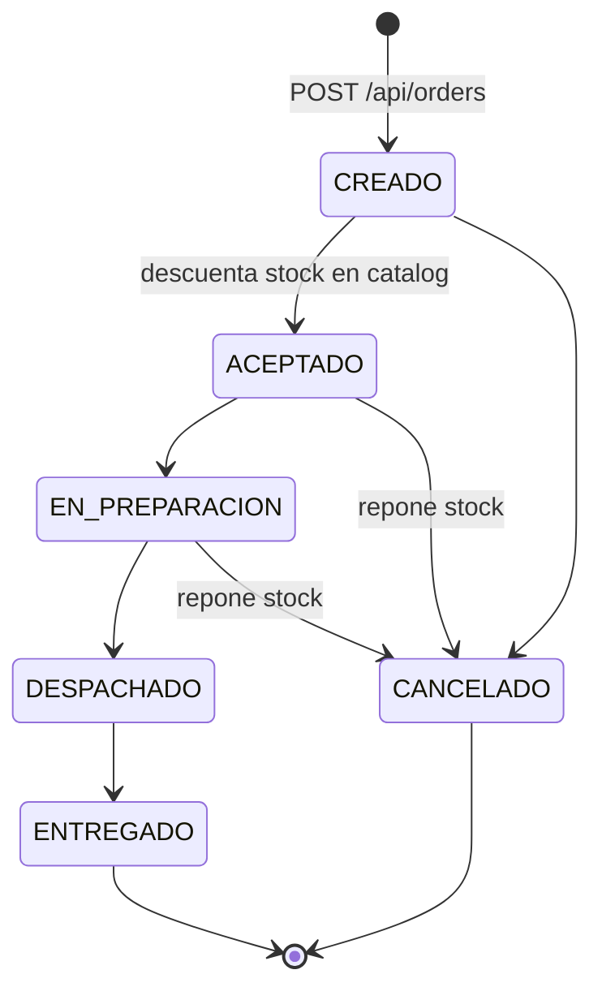

# ms-pedidos360-orders

Microservicio de pedidos de **Pedidos360** (DSY1107). Spring Boot 4.1.1 · Java 25 · PostgreSQL · RabbitMQ · puerto **8082**.
Lo consume el BFF, que le reenvía el JWT del usuario; este servicio **vuelve a validarlo** (defensa en profundidad).
Coordina el stock con **ms-pedidos360-catalog** (8081) y **produce comandos** en RabbitMQ para ms-pedidos360-notify.

## Qué cubre de la evaluación
| Requisito | Implementación |
|---|---|
| Microservicio Spring Boot que compila y pasa pruebas | `./mvnw clean verify` (135 tests; H2, sin PostgreSQL, RabbitMQ, Kafka ni Azure) |
| Integración con BD | Entidades `Pedido`, `ItemPedido`, `HistorialEstado` (JPA), base `pedidos360_orders` |
| Máquina de estados | `MaquinaEstadosPedido` (Java puro, 36 combinaciones testeadas). "No se puede despachar un pedido que no fue aceptado" → 409 |
| Integración entre microservicios | `CatalogClient` (RestClient): precios al crear, descuento de stock al **aceptar**, reposición al **cancelar** |
| Mensajería (RabbitMQ) | Productor de comandos `email.send`, `kitchen.ticket`, `invoice.gen` en `cmd.direct`, publicados **dentro de la transacción con publisher confirm**: sin Rabbit el pedido no se guarda (503) |
| Guía Parte 2 (Postman) | `POST /api/orders/test-notification` publica un `NotificationMessage` en `cmd.direct`/`email.send` (ver [Notificación de prueba](#notificación-de-prueba-guía-parte-2)) |
| Filtro que valida el JWT del IDaaS | OAuth2 Resource Server: firma (JWKS de Entra ID), `exp/nbf`, `issuer`, `audience`, scope `access_as_user` |
| Autorización | `@PreAuthorize` por rol (`Admin`, `Operador`, `Cliente`) + verificación de dueño en el servicio |
| Concurrencia | `@Version` (optimista) en `Pedido` → 409 si dos operadores lo modifican a la vez |
| Trazabilidad | `X-Request-Id` (lo lee o genera, va al log, a catalog y como `correlationId` en RabbitMQ) |
| `.gitignore` | Excluye `target/`, IDE, `.DS_Store` y `.env` |

## Máquina de estados

Cualquier otra transición (incluido quedarse en el mismo estado) responde **409** con un mensaje claro. ENTREGADO y CANCELADO son terminales.
En el JSON y en `?estado=` se acepta `"EN_PREPARACIÓN"` (con tilde) como alias de `EN_PREPARACION`; las respuestas usan siempre `EN_PREPARACION`.

## Endpoints
Todos bajo `/api/orders`, exigen scope `access_as_user` y uno de los roles indicados.

| Método | Ruta | Roles | Notas |
|---|---|---|---|
| POST | `/api/orders` | Cliente, Operador | Crea en CREADO. Nombre y precio desde catalog (el precio que envíe el cliente se ignora). No toca stock. → 201 |
| GET | `/api/orders/{id}` | Admin, Operador, Cliente | Un Cliente solo ve sus pedidos (ajeno → 404) |
| GET | `/api/orders?estado=&desde=&hasta=&page=&size=` | Admin, Operador, Cliente | Paginado, `creadoEn` desc. Un Cliente solo recibe los suyos. **Nunca** incluye cancelados ni eliminados (siguen en la BD; un cancelado se puede abrir por id) |
| PUT | `/api/orders/{id}` | Cliente (propio), Operador | Edita ítems y/o dirección **solo en CREADO** (si no, 409). Recalcula precios. Publica `OrderUpdated` y avisa al cliente |
| PUT | `/api/orders/{id}/status` | Operador, Admin (+ Cliente) | Body `{"status":"ACEPTADO","comentario":"..."}`. Un Cliente solo puede pasar **su** pedido a CANCELADO y solo en CREADO |
| GET | `/api/orders/{id}/history` | Admin, Operador, Cliente (propio) | Historial de estados, más antiguo primero |
| GET | `/api/orders/{id}/messages` | Operador | Mensajería del pedido por RabbitMQ: cada comando publicado (`ENVIADO`, con quién hizo la acción y su rol) y lo que respondió notify (`PROCESADO`, `FALLIDO` con el motivo o `EN_DLQ`). `PedidoResponse.alertaMensajeria` = true si alguno falló |
| DELETE | `/api/orders/{id}` | Operador | Borrado lógico (`eliminado = true`), solo en CREADO o CANCELADO → 204. Publica `OrderDeleted` y avisa al cliente |
| GET | `/api/orders/notifications` | Operador, Cliente | Avisos en la app del usuario (últimos 20, más recientes primero): pedido cancelado, modificado o eliminado |
| PUT | `/api/orders/notifications/read` | Operador, Cliente | Marca todos los avisos del usuario como leídos → 204 |
| GET | `/actuator/health`, `/swagger-ui.html`, `/v3/api-docs` | público | |

Códigos: **400** validación (con `detalles`) o producto inexistente en catalog · **401** token ausente/inválido/expirado · **403** falta scope o rol · **404** no existe, eliminado o ajeno · **409** transición inválida, stock insuficiente, pedido no editable o modificado en paralelo (`@Version`) · **503** catalog caído, timeout o 5xx, o RabbitMQ caído / sin confirmar la publicación (el pedido no se crea ni cambia de estado).

## Variables de entorno
| Variable | Default |
|---|---|
| `DB_URL` | `jdbc:postgresql://localhost:5432/pedidos360_orders` |
| `DB_USERNAME` / `DB_PASSWORD` | `postgres` / `postgres` |
| `ENTRA_ISSUER_URI` | `https://login.microsoftonline.com/0bfad962-b91d-465a-b769-8e71565efe7d/v2.0` |
| `ENTRA_API_CLIENT_ID` (audience) | `d80d5009-1b8a-49b2-a3da-08a8bbd00936` |
| `CATALOG_BASE_URL` | `http://localhost:8081` |
| `SERVICES_CONNECT_TIMEOUT` / `SERVICES_READ_TIMEOUT` | `2s` / `5s` |
| `RABBIT_ADDRESSES` | `localhost:5672` (clúster de `infra/mq`: `host:5672,host:5673`) |
| `RABBIT_USERNAME` / `RABBIT_PASSWORD` | `guest` / `guest` (solo local; en AWS un usuario propio) |
| `RABBIT_DECLARE_TOPOLOGY` | `true` (pasará a `false` cuando la declare el microservicio administrador) |
| `RABBIT_CONNECTION_TIMEOUT` | `3s` (espera por nodo antes de pasar al siguiente de `RABBIT_ADDRESSES`) |
| `RABBIT_CONFIRM_TIMEOUT` | `5s` (espera máxima del publisher confirm; sin él → 503 y rollback) |
| `CORS_ALLOWED_ORIGINS` | vacío (sin CORS: el navegador llama al BFF, no a orders) |

## Topología RabbitMQ
RabbitMQ **no** corre junto a orders: en AWS es un clúster de 2 nodos en su propia EC2 (`infra/mq/`), con las colas **espejadas** en ambos nodos: si cae cualquiera, el otro sigue recibiendo los comandos sin perder mensajes.
Si RabbitMQ no está disponible la app **arranca igual** y `/actuator/health` sigue en UP (`management.health.rabbit.enabled=false`), pero **crear o cambiar el estado de un pedido responde 503 y no se guarda nada**: todo pedido pasa por Rabbit, nunca queda guardado sin su comando en la cola.
Con `RABBIT_ADDRESSES=nodo1:5672,nodo2:5672`, si un nodo no responde la conexión se abre contra el otro (`RABBIT_CONNECTION_TIMEOUT` por nodo).
Con `RABBIT_DECLARE_TOPOLOGY=true`, orders declara todo al abrir su **primera** conexión, o sea, al publicar el primer mensaje (no al arrancar).

| Exchange | Tipo | Durable |
|---|---|---|
| `cmd.direct` | direct | sí |
| `cmd.topic` | topic | sí |
| `cmd.dead.dlx` | direct | sí |

Las 6 colas (`q.cmd.email`, `q.cmd.kitchen`, `q.cmd.invoice` y sus `.dlq`) son durables y se declaran **sin argumentos**. El dead-lettering lo aplican policies del broker, como en la guía de la Parte 1:

| Policy | Patrón | `dead-letter-exchange` | `dead-letter-routing-key` |
|---|---|---|---|
| `policy.email.dlx` | `^q\.cmd\.email$` | `cmd.dead.dlx` | `email.send` |
| `policy.kitchen.dlx` | `^q\.cmd\.kitchen$` | `cmd.dead.dlx` | `kitchen.ticket` |
| `policy.invoice.dlx` | `^q\.cmd\.invoice$` | `cmd.dead.dlx` | `invoice.gen` |

AMQP no puede declarar policies: en AWS vienen en `infra/mq/definitions.json` y en local las crea `docker-compose.rabbitmq.yml` al arrancar. Sin ellas, un mensaje rechazado se descarta en vez de ir a la DLQ.

> ⚠️ ms-pedidos360-notify y el futuro administrador también deben declarar estas colas **sin argumentos** (ni `x-dead-letter-*`, ni `x-queue-type`, ni `x-message-ttl`). Si difieren, RabbitMQ rechaza la declaración con `PRECONDITION_FAILED - inequivalent arg` y el consumidor no arranca. Un broker con colas creadas por la versión anterior (con `x-dead-letter-*`) se debe recrear (`docker compose down -v`).

| Exchange | Cola | Binding key |
|---|---|---|
| `cmd.direct` | `q.cmd.email` / `q.cmd.kitchen` / `q.cmd.invoice` | `email.send` / `kitchen.ticket` / `invoice.gen` |
| `cmd.topic` | `q.cmd.email` / `q.cmd.kitchen` / `q.cmd.invoice` | `email.#` / `kitchen.#` / `invoice.*` |
| `cmd.dead.dlx` | `q.cmd.email.dlq` / `q.cmd.kitchen.dlq` / `q.cmd.invoice.dlq` | `email.send` / `kitchen.ticket` / `invoice.gen` |

Orders publica solo en `cmd.direct` (mensajes persistentes, `mandatory=true`, publisher confirms `correlated` y returns: un mensaje no confirmado o no enrutable queda en el log con nivel ERROR). Cuándo se publica cada comando: ver [Contrato](#contrato-para-otros-servicios).

## Notificación de prueba (guía Parte 2)
El recorrido de la guía *Configuración Rabbit Pedidos360 – Parte 2*: Postman → `POST /api/orders/test-notification` → `cmd.direct` [`email.send`] → `q.cmd.email` → notify.

```http
POST http://localhost:8082/api/orders/test-notification
Authorization: Bearer <access token de Entra ID>
Content-Type: application/json

{ "pedidoId": 501, "email": "cliente@ejemplo.cl", "asunto": "Pedido confirmado", "mensaje": "Su pedido 501 ha sido confirmado" }
```
- Responde **202** `Solicitud de notificacion publicada`, 400 si falta un campo o el email no es válido, 401/403 sin token válido o sin rol, y 503 si RabbitMQ no responde o no confirma. Un 202 significa que RabbitMQ confirmó el mensaje en la cola, no que el correo se procesó.
- **Pide token**, a diferencia de la guía: el mismo JWT que el resto de `/api/orders/**` (scope `access_as_user`) y cualquier rol de la aplicación (`Admin`, `Operador` o `Cliente`). En Postman: *Authorization* → *Bearer Token* (el token se copia desde el front, ver `requests.http`).
- Publica el JSON **tal cual**, sin el sobre de los comandos, con la propiedad AMQP `type=TestNotification` (persistente, `content_type=application/json`). Notify reconoce ese `type` y solo registra `Notificacion recibida` / `Pedido` / `Destinatario` / `Asunto` / `Mensaje` y hace ACK, como el `NotificationConsumer` de la guía. No envía correo.
- Con notify detenido, `q.cmd.email` queda en *Ready = 1*. Al iniciarlo pasa a *Ready 0, Unacked 0, Consumers 1* (tabla de la sección 14 de la guía).
- Para publicarla desde la UI de RabbitMQ: `cmd.direct`, routing key `email.send`, *Properties* `type` = `TestNotification` y `content_type` = `application/json`. Sin ese `type`, notify la trata como un comando sin `eventId` y la manda a la DLQ.
- También está en `requests.http` (petición 0c).

## Ejecutar en local
Requisitos: Java 25 y Docker. Se levantan 4 piezas por separado, igual que en AWS: PostgreSQL, RabbitMQ, catalog y orders.

```bash
# 1) PostgreSQL de orders (5433 para no chocar con el de catalog en 5432)
docker run -d --name pg-orders -p 5433:5432 -e POSTGRES_PASSWORD=postgres -e POSTGRES_DB=pedidos360_orders postgres:17

# 2) RabbitMQ (un nodo con UI en http://localhost:15672, guest/guest)
docker compose -f docker-compose.rabbitmq.yml up -d

# 3) catalog en 8081 (ver su README). ENFORCE_ROLES=true para exigir Admin/Operador al tocar stock
cd ../ms-pedidos360-catalog && ./mvnw spring-boot:run

# 4) orders en 8082
cd ../ms-pedidos360-orders
DB_URL=jdbc:postgresql://localhost:5433/pedidos360_orders ./mvnw spring-boot:run

./mvnw clean verify         # tests (H2 + mocks; no requieren PostgreSQL, RabbitMQ, Kafka ni Azure)
```

### Con Docker Compose
```bash
cp .env.example .env                                   # ajustar valores
docker compose -f docker-compose.rabbitmq.yml up -d    # Rabbit aparte, como en AWS
docker compose up -d --build                           # orders + PostgreSQL local (override)
```
- `docker-compose.yml`: solo `orders` (imagen `ghcr.io/felruizrojas/ms-pedidos360-orders:latest`). Es el que se usa en la EC2.
- `docker-compose.override.yml`: solo local. Agrega `build: .` y un PostgreSQL 17 con volumen y healthcheck (host 5433).
- `docker-compose.rabbitmq.yml`: solo local, un nodo `rabbitmq:3.13-management` (misma versión que el clúster) que al arrancar crea las mismas 4 policies de `infra/mq` (`policy.*.dlx` y `policy.dlq.ha`) (`post_start`, requiere Docker Compose 2.30 o superior). Orders lo alcanza por `RABBIT_ADDRESSES=host.docker.internal:5672`.

## Swagger (OpenAPI)
| | |
|---|---|
| URL | http://localhost:8082/swagger-ui.html |
| Spec JSON | `curl http://localhost:8082/v3/api-docs` |

Esquema de seguridad `bearerAuth` (JWT) global: botón **Authorize** → pegar el token (sin `Bearer `). Cada endpoint documenta 400/401/403/404/409/503 con el esquema `ErrorBody`.

## Pruebas manuales (curl)

`TOKEN`: access token de Entra ID con scope `api://d80d5009-1b8a-49b2-a3da-08a8bbd00936/access_as_user`.
Se obtiene iniciando sesión en el frontend → DevTools → Network → cualquier llamada a `/api/...` → header `Authorization` (copiar lo que va después de `Bearer `).
El rol sale del claim `roles` (App roles de Entra): para el flujo completo conviene un usuario con `Cliente` (crea pedidos) y otro con `Operador` o `Admin` (cambia estados y edita); para probar las restricciones, el de solo `Cliente`.
Un flujo completo listo para ejecutar está en [`requests.http`](requests.http) (VS Code REST Client o IntelliJ).

```bash
BASE=http://localhost:8082
TOKEN="<access token>"
H=(-H "Authorization: Bearer $TOKEN" -H "Content-Type: application/json")

curl -i $BASE/actuator/health                                  # 200 {"status":"UP"} (aunque Rabbit esté caído)
curl -i $BASE/api/orders                                       # 401 sin token

# Crear (solo Cliente) -> 201, estado CREADO, precios desde catalog
curl -i -X POST $BASE/api/orders "${H[@]}" \
  -d '{"direccionEntrega":"Av. Providencia 1234, Santiago","items":[{"productoId":1,"cantidad":2},{"productoId":4,"cantidad":1}]}'

curl -i -X POST $BASE/api/orders "${H[@]}" -d '{"direccionEntrega":"","items":[]}'          # 400 con detalles
curl -i -X POST $BASE/api/orders "${H[@]}" \
  -d '{"direccionEntrega":"Dir","items":[{"productoId":99999,"cantidad":1}]}'              # 400 producto inexistente

curl -i "${H[@]}" $BASE/api/orders/1                                                      # 200 (404 si es ajeno y eres Cliente)
curl -i "${H[@]}" "$BASE/api/orders?estado=CREADO&desde=2026-10-01&hasta=2026-12-31&page=0&size=10"

# Editar (solo en CREADO; Cliente sus pedidos, Admin/Operador cualquiera)
curl -i -X PUT $BASE/api/orders/1 "${H[@]}" -d '{"direccionEntrega":"Los Leones 456, Providencia"}'

# Despachar sin aceptar -> 409 "No se puede despachar un pedido que no fue aceptado"
curl -i -X PUT $BASE/api/orders/1/status "${H[@]}" -d '{"status":"DESPACHADO"}'

# Flujo feliz (Operador/Admin): ACEPTADO baja el stock en catalog
for s in ACEPTADO EN_PREPARACIÓN DESPACHADO ENTREGADO; do
  curl -s -X PUT $BASE/api/orders/1/status "${H[@]}" -d "{\"status\":\"$s\"}" | head -c 200; echo
done
curl -i "${H[@]}" $BASE/api/orders/1/history                                              # 5 filas

# Cancelar un pedido ACEPTADO -> repone stock en catalog
curl -i -X PUT $BASE/api/orders/2/status "${H[@]}" -d '{"status":"CANCELADO","comentario":"Sin repartidor"}'

curl -i -X DELETE "${H[@]}" $BASE/api/orders/2                                            # 204 (solo Admin; CREADO o CANCELADO)
```

## Decisiones de diseño
- **Stock al aceptar, todo o nada**: orders manda todos los ítems en un solo `POST /stock/decrease`; catalog lo hace en una transacción con `UPDATE ... WHERE stock >= :cantidad`. Si no alcanza → 409, el pedido sigue en CREADO y no se publica nada.
- **Orden en `cambiarEstado`**: 1) validar con la máquina de estados, 2) llamar a catalog, 3) `saveAndFlush` (para que un conflicto de `@Version` aparezca antes del commit), 4) publicar en Rabbit, 5) si el guardado o la publicación fallan, **compensa** en catalog: repone lo descontado (aceptar) o vuelve a descontar lo repuesto (cancelar), y lo registra en el log. Si la compensación también falla queda en el log como `COMPENSACIÓN FALLIDA` (corrección manual). TODO: **idempotencia** del descuento (clave por pedido/operación en catalog) para que un reintento no descuente dos veces.
- **Publicación dentro de la transacción, con confirm**: el servicio emite `PedidoEstadoCambiadoEvent` (evento de aplicación de Spring, una foto inmutable del pedido) y `PedidoCommandListener` (`@EventListener`, síncrono) publica en Rabbit y espera el publisher confirm de cada mensaje (`ConfirmacionBroker`). Rabbit caído, nack, mensaje no enrutable (`mandatory`) o sin confirm en `RABBIT_CONFIRM_TIMEOUT` → `ServicioNoDisponibleException` → rollback y **503**. Caso borde que queda: Rabbit confirma y luego falla el commit (el `saveAndFlush` previo lo deja casi imposible); el patrón **outbox** lo cerraría del todo.
- **Kafka**: fuera de alcance. Las dependencias de Initializr quedan en el pom sin configuración ni código (sin beans de Kafka no hay conexión al broker). El mismo `PedidoEstadoCambiadoEvent` se usará para `orders.events` / `audit.timeline` (TODO en el listener).
- **Clientes y dueño**: el `clienteId` es el claim `oid` (o `sub`). Un usuario que no es Admin ni Operador solo ve y modifica sus pedidos; uno ajeno responde **404** (no 403) para no revelar que existe. Si un usuario tiene varios roles, manda el de más privilegios.
- **Solo Cliente crea pedidos**: el enunciado también lo permite a Operador, pero se restringió a Cliente porque un pedido necesita una cuenta de cliente (el request no tiene campo de cliente y el pedido queda a nombre de quien lo crea). Admin y Operador los gestionan desde el dashboard: cambian estado y editan ítems/dirección en CREADO.
- **Cliente que intenta otro estado** que no sea CANCELADO → 403; cancelar un pedido propio ya ACEPTADO → 409 (solo puede en CREADO, cuando no hay stock que reponer).
- **Historial**: al crear se registra una fila inicial `null → CREADO`, así el historial muestra quién creó el pedido. `usuarioRol` es el rol de más privilegio del token.
- **Ítems repetidos**: el mismo `productoId` repetido en el request se agrupa en un solo ítem (suma de cantidades). Límites: 50 ítems y 1.000 unidades por ítem.
- **Fechas del listado**: `desde`/`hasta` aceptan instante con zona (`2026-10-01T00:00:00Z`, `...-03:00`) o fecha sola (UTC; en `hasta` incluye el día completo). `size` se acota a 1..100 y `page` < 0 se trata como 0.
- **Errores de catalog**: conexión rechazada, timeout o 5xx → 503 (sin filtrar el detalle) · 409 → 409 con el mismo `mensaje` y `detalles` · 404 de un producto → 400 con `detalles` · 401/403 → se propagan.
- **Topología declarada en la primera conexión**: no al arrancar, para que la app no dependa de que Rabbit esté arriba (aunque sin Rabbit no se pueden crear pedidos). Las colas aparecen en la UI al publicar el primer mensaje.
- **`messageId` AMQP = `correlationId`**, como pide el enunciado. Para deduplicar, los consumidores deben usar `eventId` (del cuerpo), que es único por mensaje: una misma petición puede generar 2 mensajes (p. ej. `email.send` + `kitchen.ticket`) con el mismo `correlationId`.
- **`traceId`**: sin una librería de tracing distribuido, es el mismo `X-Request-Id`.
- **`ddl-auto: update`** como catalog (sin Flyway); `open-in-view: false`, por eso todo el mapeo a DTO ocurre dentro de las transacciones del servicio.

## Contrato para otros servicios
Fuente única del contrato de orders para el BFF, el front y notify.

### Formato de error (igual que catalog)
```json
{
  "timestamp": "2026-10-20T15:04:05.123Z",
  "status": 409,
  "error": "Conflict",
  "mensaje": "No se puede despachar un pedido que no fue aceptado (estado actual: CREADO)",
  "detalles": { "estadoActual": "CREADO", "estadoSolicitado": "DESPACHADO" }
}
```
`detalles` es opcional:
- **400 de validación**: `{"campo": "mensaje"}`, p. ej. `{"direccionEntrega":"La dirección de entrega es obligatoria.","items[0].cantidad":"La cantidad debe ser mayor que 0."}`.
- **400 por producto inexistente**: `{"items[1].productoId":"El producto 99 no existe en el catálogo"}`.
- **400 por estado desconocido**: `{"status":"Estado inválido: \"VOLANDO\". Valores permitidos: [...]"}`.
- **409 por transición**: `{"estadoActual","estadoSolicitado"}`.
- **409 por stock** (reenviado tal cual desde catalog): `{"productoId":1,"solicitado":5,"disponible":2}`.
- 401/403/404/503 y el resto de los 409 no traen `detalles`.

> Nota para el BFF: debe propagar **409** y **503** de orders con el cuerpo tal cual (hoy el BFF traduce todo lo que no es 400/401/403 a 502).

### Pedido (`PedidoResponse`)
```json
{
  "id": 15,
  "clienteId": "4f6c2a1e-1111-2222-3333-444455556666",
  "clienteNombre": "María Pérez",
  "clienteEmail": "maria@contoso.cl",
  "direccionEntrega": "Av. Providencia 1234, Santiago",
  "estado": "ACEPTADO",
  "total": 2700.00,
  "stockDescontado": true,
  "items": [
    { "id": 31, "productoId": 1, "productoNombre": "Pan Amasado", "precioUnitario": 600.00, "cantidad": 2, "subtotal": 1200.00 },
    { "id": 32, "productoId": 4, "productoNombre": "Café Americano", "precioUnitario": 1500.00, "cantidad": 1, "subtotal": 1500.00 }
  ],
  "creadoEn": "2026-10-20T15:04:05.123Z",
  "aceptadoEn": "2026-10-20T15:10:00.456Z",
  "enPreparacionEn": null,
  "despachadoEn": null,
  "entregadoEn": null,
  "canceladoEn": null,
  "motivoCancelacion": null,
  "version": 1
}
```
Fechas ISO-8601 en UTC; montos con 2 decimales. `estado` ∈ `CREADO | ACEPTADO | EN_PREPARACION | DESPACHADO | ENTREGADO | CANCELADO`.

### `POST /api/orders` → 201 `PedidoResponse`
```json
{ "direccionEntrega": "Av. Providencia 1234, Santiago",
  "items": [ { "productoId": 1, "cantidad": 2 }, { "productoId": 4, "cantidad": 1 } ] }
```
Validación: `direccionEntrega` no vacía (máx. 200); `items` entre 1 y 50; `productoId > 0`; `cantidad` entre 1 y 1000. No se envía precio ni datos del cliente (salen de catalog y del JWT).

### `PUT /api/orders/{id}` → 200 `PedidoResponse`
```json
{ "direccionEntrega": "Los Leones 456, Providencia", "items": [ { "productoId": 4, "cantidad": 3 } ] }
```
Ambos campos opcionales (al menos uno). `items`, si viene, **reemplaza** todos los ítems. Solo en CREADO (si no → 409).

### `PUT /api/orders/{id}/status` → 200 `PedidoResponse`
```json
{ "status": "CANCELADO", "comentario": "Cliente no estaba en el domicilio" }
```
`comentario` opcional (máx. 500); al cancelar queda en `motivoCancelacion`.

### `GET /api/orders?estado=&desde=&hasta=&page=0&size=20` → 200
```json
{ "contenido": [ { "id": 15, "estado": "CREADO", "...": "PedidoResponse" } ],
  "pagina": 0, "tamano": 20, "totalElementos": 1, "totalPaginas": 1 }
```

### `GET /api/orders/{id}/history` → 200
```json
[
  { "estadoAnterior": null, "estadoNuevo": "CREADO", "usuarioId": "4f6c...", "usuarioNombre": "María Pérez",
    "usuarioRol": "Cliente", "fecha": "2026-10-20T15:04:05.123Z", "comentario": null },
  { "estadoAnterior": "CREADO", "estadoNuevo": "ACEPTADO", "usuarioId": "9a1b...", "usuarioNombre": "Olga Operadora",
    "usuarioRol": "Operador", "fecha": "2026-10-20T15:10:00.456Z", "comentario": null }
]
```

### `DELETE /api/orders/{id}` → 204 sin cuerpo

### Mensajes RabbitMQ (exchange `cmd.direct`)
| Routing key → cola | Cuándo | `type` |
|---|---|---|
| `email.send` → `q.cmd.email` | Al crear, en **cada** cambio de estado (incluida la cancelación), al editar y al eliminar | `OrderCreated` / `OrderStatusChanged` / `OrderUpdated` / `OrderDeleted` |
| `kitchen.ticket` → `q.cmd.kitchen` | Al pasar a ACEPTADO (además del email) | `KitchenTicketRequested` |
| `invoice.gen` → `q.cmd.invoice` | Al pasar a ENTREGADO (además del email) | `InvoiceRequested` |

Propiedades AMQP: `delivery_mode=2` (persistente), `content_type=application/json`, `type` = el `type` del sobre, `correlation_id` y `message_id` = `correlationId` (el `X-Request-Id`). Spring agrega el header `__TypeId__` con la clase Java de orders: los consumidores deben **ignorarlo** y leer el JSON como su propio DTO (p. ej. `JacksonJsonMessageConverter` con un tipo destino fijo en el `@RabbitListener`).

Sobre (igual para las 3 routing keys):
```json
{
  "type": "OrderStatusChanged",
  "eventId": "0f8c7a52-3c1e-4a7e-9d43-6a1f0b9e2c11",
  "timestamp": "2026-10-20T15:10:00.789Z",
  "traceId": "req-123",
  "correlationId": "req-123",
  "payload": {
    "pedidoId": 15,
    "clienteId": "4f6c2a1e-1111-2222-3333-444455556666",
    "clienteNombre": "María Pérez",
    "clienteEmail": "maria@contoso.cl",
    "estadoAnterior": "CREADO",
    "estadoNuevo": "ACEPTADO",
    "total": 2700.00,
    "items": [
      { "productoId": 1, "productoNombre": "Pan Amasado", "cantidad": 2, "precioUnitario": 600.00, "subtotal": 1200.00 },
      { "productoId": 4, "productoNombre": "Café Americano", "cantidad": 1, "precioUnitario": 1500.00, "subtotal": 1500.00 }
    ],
    "fecha": "2026-10-20T15:10:00.456Z"
  }
}
```
- `eventId`: UUID **único por mensaje**; los consumidores lo usan para ser idempotentes (la entrega es al-menos-una-vez).
- `estadoAnterior` es `null` en `OrderCreated`. En `OrderUpdated` y `OrderDeleted` el estado no cambia (`estadoAnterior` = `estadoNuevo`).
- `usuarioId`, `usuarioNombre`, `usuarioRol`: **quién hizo la acción** (el Cliente al crear, editar o cancelar su pedido; el Operador al cambiar de estado, editar o eliminar).
- **Vuelta (notify → orders):** por cada comando, notify publica en `evt.direct` (routing key `resultado.comando` → `q.orders.resultados`) un `ResultadoComando` `{eventId, comandoEventId, pedidoId, comando, type, resultado, motivo, cola, fecha, correlationId}` con `resultado` = `PROCESADO` (ACK), `FALLIDO` (NACK) o `EN_DLQ` (lo informa el listener de la DLQ, incluido lo que expiró por TTL). orders lo guarda en `mensaje_comando` y el operador lo ve en el detalle del pedido.
- Al cancelar, editar o eliminar, el mismo evento deja además un aviso en la app (tabla `notificacion`) dentro de la misma transacción: si RabbitMQ no confirma, no queda ni el cambio ni el aviso (503).
- `fecha`: momento del cambio de estado (el mismo valor del timestamp correspondiente en el pedido). `timestamp`: momento de publicación.
- El payload es el mismo para las 3 routing keys: `email.send` usa `clienteEmail`/`clienteNombre`/estados, `kitchen.ticket` usa `items`, `invoice.gen` usa `items` y `total`.

#evaluacion 2